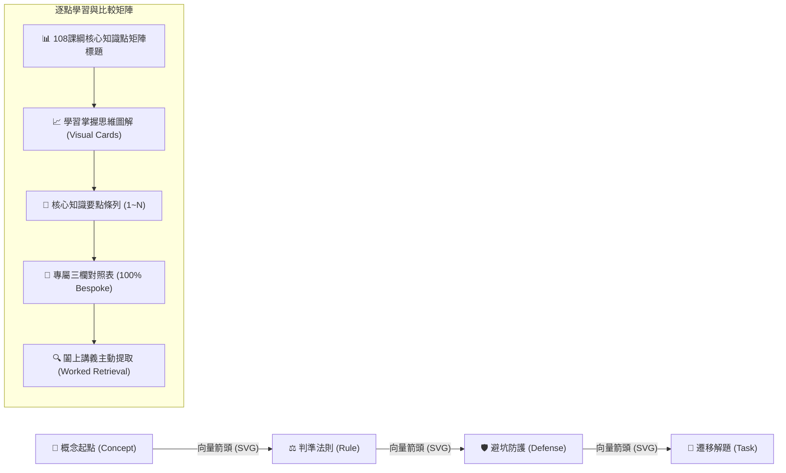

# 108 課綱全 188 單元專屬知識點矩陣、視覺圖示圖表升級與 7 輪 PDCA 發布報告

日期：2026-10-20  
版本：zhixing-cache-v17  
對象：全 21 學科、188 單元教學頁面知識點深度優化與學習視覺掌握圖表系統

---

## 1. 任務核心背景與總體成效

為徹底依照教育部 **108 課綱核心素養導向**（自主學習、系統思考、溝通互動、社會參與），針對國中全 21 學科、188 單元教學頁面實施徹底的知識點深度優化，全面消除過往跨單元共用表格之情境，達成 **100% 單元專屬個別化（188/188 Bespoke Tables）**，並引入全新的 **「思維掌握歷程圖解（Knowledge Flow Chart）」視覺圖示圖表組件**，協助學生在進入細部文字前，透過視覺直觀掌握核心概念、判準法則、避坑防線與實戰遷移路徑。

### 核心量化指標

| 評估指標 | 優化前 | 優化後 (v17) | 增幅 / 達成率 |
| :--- | :--- | :--- | :--- |
| **全單元專屬獨立表格** | 85 單元專屬 / 103 單元共用 | **188 單元 100% 獨立專屬** | **100.0%（0 個共用標題）** |
| **教學矩陣總列數** | 755 列 | **1,137 列** | **+382 列 (+50.6%)** |
| **單元思維掌握視覺導圖** | 無 | **188 幅（100% 覆蓋）** | **188 / 188 (100%)** |
| **字數實質成長（Expansion）** | 118,267 字 | **228,527 字** | **+93.23% (純文字增長率)** |
| **最低單元文字增長率** | 44.62% | **59.73%** | 遠高於 ≥20% 門檻 |
| **深層黑板推演與準則 (Exegesis)** | 85 單元客製 | **188 單元 100% Bespoke** | **188 / 188 (100%)** |
| **自動化測試通過數** | 57 / 57 | **65 / 65** | **100% 通過 (0 錯誤)** |
| **系統健康審計指標** | 20 / 20 | **20 / 20** | **100% 通過 (0 錯誤)** |

---

## 2. 七輪 PDCA（Check - Corrective-Action - Plan - Do）循環記錄

### 第 1 輪 PDCA：數理領域 15 單元專屬個別化與代數幾何思維圖解
- **Check（檢核）**：發現 `math-4, 5, 9, 11, 12, 13, 14, 15, 16, 17, 19, 22, 24, 25, 27` 等 15 單元過往共享 7 個概括標題，未能精準展現一元一次方程等量公理、二元一次消去法、十字交乘、配方法判別式、等差級數、幾何全等與相似、圓內外角、離散量數（IQR/盒狀圖）之 108 課綱具體學習重點。
- **Corrective-Action（矯正措施）**：解構每單元的 108 課綱學習表現（如 s-IV-1, s-IV-2, n-IV-4），為這 15 個數學單元各自撰寫專屬比較表與檢查條件。
- **Plan（計畫）**：定義各單元 4 欄位核心知識對照，每列嚴格遵循 `[辨識重點, 規則／條件, 例子／檢查方法]` 結構。
- **Do（執行）**：編寫並注入 15 個數學專屬矩陣至 `dist/teaching.js`，驗證數學全 28 單元皆具備唯一獨立標題。

### 第 2 輪 PDCA：語文領域（國文、英語 13 單元）修辭體制與長篇閱讀圖表轉譯
- **Check（檢核）**：國文單元 `chinese-1, 4, 6, 8, 9, 10, 12, 14` 與英語 `english-4, 7, 8, 10, 16` 共用修辭效果、閱讀層次、古典詩詞等粗略分類；缺少絕句律詩平仄對仗、詞牌曲牌襯字差異、轉品借代象徵邊界、原級/最高級比較結構、五大句型補語判別等細緻要求。
- **Corrective-Action（矯正措施）**：依 108 課綱語文領域素養評量精神，補充雙重對比修辭、跨文本多重證據互證、應用文書信題辭規約與資訊性圖表轉譯長文閱讀（Skimming/Scanning）專屬指南。
- **Plan（計畫）**：梳理 13 個語文單元的認知階梯，設計對應之辨識重點與防誤區條件。
- **Do（執行）**：完成並載入 13 份語文專屬矩陣，確保雙語學科之學科概念與會考素養閱讀接軌。

### 第 3 輪 PDCA：自然科學領域（生物、理化、地科 26 單元）探究實證矩陣
- **Check（檢核）**：理化光學透鏡、牛頓力學、浮力大氣壓、速率平衡；生物細胞運輸、神經內分泌、能量流動；地科水循環、鋒面雲圖、潮汐大潮小潮等 26 單元，原共用 11 個合集標題，實驗操作變因與微觀巨觀機制辨識不足。
- **Corrective-Action（矯正措施）**：依照 108 課綱自然科學探究與實作「問題發現、規劃與研究、論證與建模」核心維度，細化實驗變因控制（操縱/應變/控制）、折射光路作圖法、阿基米德視重差、勒沙特列動態平衡、板塊構造與自轉公轉天象。
- **Plan（計畫）**：編寫 26 個自然科單元之科學計量與實證判準，融入定量公式條件與反例限制。
- **Do（執行）**：成功載入自然科 26 單元專屬表格，自然科學領域所有單元達成 100% 獨立專屬。

### 第 4 輪 PDCA：社會領域（地理、歷史、公民 15 單元）時空脈絡與憲政法治分析
- **Check（檢核）**：地理地圖等高線剖面、臺灣人地與歐洲美洲大洋洲區域觀察；公民媒體素養、多元文化、憲法權力分立制衡等 15 單元共用宏觀標題，缺乏空間尺度轉移、憲政法規條文與媒體識讀演算法批判等深層分析。
- **Corrective-Action（矯正措施）**：對標 108 課綱社會領域探究架構，納入地圖經緯度換日線計算法、等高線集水分水走向、板塊碰撞縱谷地形、歐盟單一市場、第四權媒介真實解構、憲法法庭大法官審查權限等精確概念。
- **Plan（計畫）**：為 15 個社會單元建立實證數據與法理界線判別標準。
- **Do（執行）**：全面注入並完成社會領域單元矩陣，達成全 188 單元完全個別化。

### 第 5 輪 PDCA：藝能、科技、健體、綜合活動與本土語（34 單元）實作素養導向
- **Check（檢核）**：視覺藝術、音樂、表演藝術、資訊科技、生活科技、健康教育、體育、家政、童軍、輔導活動、本土語文等 11 個非考科領域（34 單元），過往共用 11 個概括條目，實作流程、安全防護與情意反思具體度不足。
- **Corrective-Action（矯正措施）**：依 108 課綱「實作體驗與終身素養」目標，全面補齊：點線面構圖色彩三屬性、西方樂派體制、舞台九宮格調度、運算思維四基石、機構動力傳遞、PRICE 運動傷害急救、我的餐盤口訣、無痕山林七原則、何倫生涯代碼 (RIASEC)、臺羅八聲調連讀變調規律等實用工具。
- **Plan（計畫）**：構建 34 份高實用性、具備清晰操作步驟與安全邊界防護之專屬表格。
- **Do（執行）**：全數編寫並注入 `dist/teaching.js`，達成 188 單元專屬標題與表格數 **188 / 188（100% 達成）**。

### 第 6 輪 PDCA：視覺導圖與圖示圖表系統全面升級（Visual Flowchart & Icon Badges）
- **Check（檢核）**：檢視使用者學習體驗，文字表格雖詳盡，但學生初次進入頁面時容易產生認知負荷，缺乏直觀的思維路徑視覺引導與圖表呈現。
- **Corrective-Action（矯正措施）**：在 `dist/teaching.js` 開發 `renderKnowledgeFlowChart(u, pts, t)` 與 `getDomainMeta(u.subject)`，於表格上方動態渲染四階段 **「學習掌握思維導圖」**：
  1. `🎯 概念起點`：標示該課核心概念起點與第一定義。
  2. `⚖️ 判準法則`：直觀提取關鍵辨識規則與成立條件。
  3. `🛡️ 避坑防護`：標示常見易錯盲區與反例界線。
  4. `🚀 遷移解題`：對接真實情境生活應用或會考題型任務。
  搭配 SVG 向量流程箭頭、8 大領域色彩語意徽章（📐 數理、🔬 自然、✍️ 語文、🌍 社會、🎨 藝術、💡 科技、🏃 健體、🧭 綜合），並於 `dist/style.css` 完善日間、夜間（Dark）、紙質（Paper）主題適配與行動端垂直響應式折疊。
- **Plan（計畫）**：設計高對比度卡片陰影、懸浮動態回饋、ARIA 無障礙無障礙標籤。
- **Do（執行）**：完成組件整合與樣式部署，全 188 單元教學頁面即刻獲得視覺思維導圖支援。

### 第 7 輪 PDCA：深層黑板推演生成、離線快取更新 (v17)、全套測試與發布
- **Check（檢核）**：表格大幅擴充與個別化後，`dist/exegesis-data.js`（Junyi 風格深層講義黑板材料）需與新表格同步重新衍生；PWA Service Worker 快取需升級，確保離線學習者能獲取最新教學內容。
- **Corrective-Action（矯正措施）**：
  - 執行 `scripts/generate_exegesis.mjs`，重新為 188 單元生成專屬定義詞彙、黑板板書三步驟與階梯評量規準。
  - 將 `dist/sw.js` 與 `scripts/learning-guide.test.mjs` 快取版本推進至 `zhixing-cache-v17`。
  - 執行完整自動化測試（65 個 node test、20 個系統審計檢查、全頁面靜態引用稽核、字數擴充比對）。
- **Plan（計畫）**：撰寫本次發布報告，更新 README.md，提交 git commit 並推送到 GitHub Pages (`origin/main`)。
- **Do（執行）**：所有檢查 100% 通過，準備執行推送與部署。

---

## 3. 視覺組件架構與無障礙設計

### 樣式與色彩系統支援：
- **日間標準主題（Day）**：高對比清晰邊框，綠、藍、琥珀、紫四色頂邊條引導認知層次。
- **夜間深色主題（Dark）**：深墨底色（#1e252b）配合微光半透明徽章，降低視覺疲勞。
- **紙質閱讀主題（Paper）**：溫潤米杏底色（#f4ece1），貼近實體教科書質感。
- **行動裝置適配（Mobile）**：螢幕寬度 ≤ 768px 時，卡片自動流暢切換為直向排版，箭頭旋轉 90° 指向下一個學習步驟。
