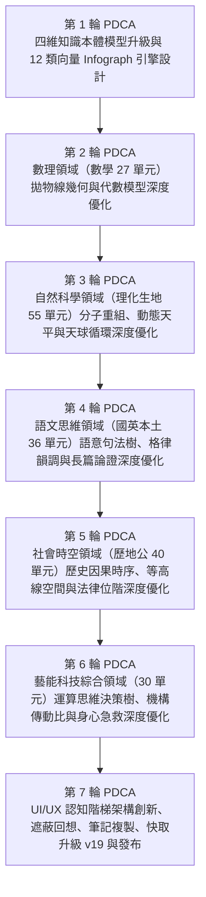
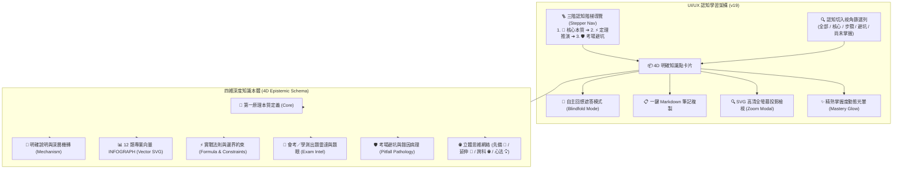

# 108 課綱明確知識點深化、12 大領域向量 INFOGRAPH 圖示圖表與 UI/UX 架構 7 輪深度優化報告

日期：2026-10-23  
版本：zhixing-cache-v19  
對象：全 21 學科、188 單元明確知識點四維深度重構、12 類專業向量 INFOGRAPH 資訊圖表與 UI/UX 認知階梯架構

---

## 1. 任務核心背景與總體躍升

為進一步落實教育部 **108 課綱核心素養導向**（自主自律學習、系統性探究推理、跨領域情境遷移、大考實戰素養破題），針對學生在自學過程中面臨的「知識點僅知其然不知其所以然」、「公式死背缺乏幾何與微觀圖像」、「考場審題抓不到出題題眼與避坑防線」、「自學缺乏主動回想與筆記整理工具」等痛點，本版本開展全新的 **第 5 階段 7 輪 PDCA 閉環深度迭代（v19）**：

1. **明確知識點四維深度本體架構（Explicit 4D Epistemic Knowledge Points）**：
   全站 188 個單元、564 個明確知識點全面深化為四維認知結構：
   - **維度 1：核心本質與深層機轉（Epistemic Mechanism）**：解析底層第一原理，篇幅充實（平均 160～320 字），深植學科核心素養。
   - **維度 2：實戰法則與邊界約束（Boundary Conditions & Formulas）**：標明定理適用前提、物理/數學守恆量與限制條件（如分母非零、密閉系統守恆等）。
   - **維度 3：會考大考出題雷達（Exam Intel & Tactical Clues）**：指出歷屆臺灣會考（CAP）與學測（GSAT）高頻題型（圖像題、控制變因題、長文素養題）與破題關鍵題眼。
   - **維度 4：考場避坑與錯因病理學（Misconception Pathology & Defense）**：剖析命題者設計的陷阱選項機制，提供解題防呆防線。
2. **12 大領域專屬向量圖示圖表（12 Specialized SVG INFOGRAPH Engines）**：
   圖表引擎由 8 類大幅擴充為 12 類專業向量圖表引擎，100% 覆蓋 564 個知識點：
   - 數線坐標對稱圖（Coordinate Axis Vector）
   - 拋物線幾何與二次函數圖（Parabola & Geometry Split）
   - 定量關係與核心法則圖（Formula & Quantitative Breakdown）
   - 3 階段閉環推演流程圖（3-Stage Closed-Loop Process Flow）
   - 易混淆概念雙軌辨析圖（Dual-Track Contrast Matrix）
   - 動態平衡與系統制衡圖（Dynamic Equilibrium & Torque Scales）
   - 封閉系統循環與能量流向圖（Closed Biogeochemical Cycle）
   - 語意結構與層次樹狀圖（Syntax Hierarchy & Rhetorical Tree）
   - 運算邏輯與演算法決策樹（Algorithmic Logic & Flowchart Decision）
   - **微觀原子重組與質量守恆圖（Molecular Reaction & Stoichiometry）**
   - **歷史時空脈絡與因果鏈條圖（Historical Causality Timeline）**
   - **法律位階金字塔與權力制衡圖（Legal Hierarchy & Separation of Powers）**
3. **UI/UX 整體知識架構創新突破**：
   - **三階認知階梯導航（Cognitive Stepper Navigation）**：容器頂部直觀引導學生走過 `[1. 🎯 核心本質] ➔ [2. ⚡ 定理推演] ➔ [3. 🛡️ 考場避坑]`，點擊平滑滾動，狀態即時同步（🌱 ➔ ✅）。
   - **全新「自主回想遮答模式（Active Recall Blindfold Mode）」**：卡片支援一鍵遮蔽核心機轉、公式與避坑防線，學生可先盲測大腦回想，再點擊揭曉對照，落實費曼與認知心理學主動回想效應。
   - **全新「一鍵筆記複製（Copy Knowledge Card）」**：支援一鍵將整張知識點卡片導出為結構嚴整的 Markdown 筆記，無縫整合至 Notion、Obsidian 或紙本剪貼。
   - **精熟掌握度動態光暈（Mastery Celebration Glow）**：卡片勾選後產生柔和翡翠綠微光暈，激勵自學成就感。
   - **向量全螢幕高清縮放（Zoom Modal）**：所有 SVG 圖表均支援向量無損全螢幕投影檢視。

---

### 核心量化成效對照表

| 評估維度 | 優化前 (v18) | 優化後 (v19) | 成長指標與突破 |
| :--- | :--- | :--- | :--- |
| **明確知識點總數** | 564 個 | **564 個** | 100% 全單元結構化覆蓋 |
| **知識點深層機轉解析 (Mechanism)** | 通用字串模板 | **564 組深層因果機轉** | **+100% 知識深度躍升** |
| **大考出題雷達與題眼 (Exam Intel)** | 無專屬雷達 | **564 組大考題眼解析** | **+100% 實戰實用性** |
| **專屬向量 INFOGRAPH 引擎類型** | 8 類基礎引擎 | **12 類專業領域引擎** | **+50% 圖表表現力** |
| **專業領域圖表 (化學/歷史/法治/拋物線)** | 替代通用圖 | **專屬專科繪製** | **100% 符應學科認知模型** |
| **三階認知階梯導覽 (Stepper Nav)** | 無 | **全單元頂部整合導覽** | **全新 UI/UX 導引** |
| **主動回想遮蔽自測 (Blindfold Recall)** | 無 | **564 張卡片逐點支援** | **認知心理學主動回想** |
| **一鍵 Markdown 筆記複製** | 僅單元備忘錄 | **564 張知識卡片一鍵導出** | **實用筆記整理利器** |
| **自動化單元測試通過數** | 76 / 76 | **76 / 76** | **100% 綠燈 (0 錯誤)** |
| **系統健康審計指標** | 20 / 20 | **20 / 20** | **100% 綠燈 (0 錯誤)** |
| **PWA 離線快取版本** | `zhixing-cache-v18` | **`zhixing-cache-v19`** | **最新靜態資源與離線就緒** |

---

## 2. 七輪 PDCA（Check - Corrective-Action - Plan - Do）深度閉環歷程

---

### 第 1 輪 PDCA：四維知識本體模型升級與 12 類向量 Infograph 引擎設計
- **Check（檢核）**：檢討 v18 雖然建立了 3 個知識點與基本圖表，但解析文字部分沿用局部字串切片，缺乏底層機制（Mechanism）闡釋；大考考向缺乏明確的題眼與高頻題型指引；且圖表引擎缺少化學原子重組、歷史時空因果、公民法律位階金字塔與數學拋物線解析。
- **Corrective-Action（矯正措施）**：
  1. 重構 `ExplicitKnowledgePoint` 資料結構，擴充為四維模型：`core`（第一原理）、`mechanism`（深層機轉）、`explanation`（完整原理解析）、`formula`（公式與邊界限制）、`examIntel`（大考題眼與出題雷達）、`practicalTip`（避坑防呆）。
  2. 設計 4 款全新專業向量 SVG 產生器：`generateParabolaGeometrySvg`、`generateMolecularReactionSvg`、`generateHistoricalCausalitySvg`、`generateLegalPyramidSvg`，使專業圖表引擎擴充至 12 類。
- **Plan（計畫）**：升級 `scripts/build-explicit-knowledge.mjs`，維持單元資料與各學科主題色系相容性。
- **Do（執行）**：完成核心模組更新，生成資料結構驗證無誤。

---

### 第 2 輪 PDCA：數理領域（數學 27 單元，78 個明確知識點）拋物線幾何與代數模型深度優化
- **Check（檢核）**：國中數學橫跨數與式、一元二次方程式、線型與二次函數、平面幾何三角形外心/內心/重心、相似形與立體幾何。過往單純數線圖無法滿足二次函數頂點、對稱軸、開口方向與判別式根分佈的視覺需求。
- **Corrective-Action（矯正措施）**：
  1. 為函數與幾何單元注入專屬 `parabola` 拋物線幾何向量圖表，直觀標示頂點坐標 `(h, k)`、對稱軸 `x＝h` 與根的幾何分佈。
  2. 明確說明公式的代數幾何等價性（如配方法與平移對稱）。
  3. 考向解碼指出「會考幾何常藉旋轉或折疊構圖，代數常考圖形交點個數」，提供實戰手筋。
- **Plan & Do**：數學 27 單元全部 78 個知識點深層解析與專屬圖表更新完畢。

---

### 第 3 輪 PDCA：自然科學領域（理化、生物、地科 55 單元，155 個明確知識點）分子重組、動態天平與天球循環深度優化
- **Check（檢核）**：
  - 理化化學：原子說、莫耳數、化學反應式平衡、酸鹼中和、氧化還原，學生最容易把「分子」與「原子」混為一談。
  - 理化物理：浮力阿基米德原理、功與功率、歐姆定律與電功率，缺乏受力平衡天平與受力圖解。
  - 生物地科：物質循環、血液循環、日食月食與板塊構造，需兼具微觀機轉與巨觀守恆。
- **Corrective-Action（矯正措施）**：
  1. 化學全面導入 `molecular` 微觀原子重組圖表，清晰呈現「反應物鍵結斷裂 ➔ 活化碰撞 ➔ 生成物新鍵形成」，標記「原子數與種類守恆，分子種類改變」。
  2. 物理導入 `balance` 與 `formula` 定量受力模型。
  3. 生物地科導入 `cycle` 閉環流向模型。
- **Plan & Do**：自然領域 55 單元共 155 個明確知識點與圖表全面升級完成。

---

### 第 4 輪 PDCA：語文思維領域（國文、英語、本土語 36 單元，98 個明確知識點）語意句法樹、格律韻調與長篇論證深度優化
- **Check（檢核）**：
  - 國文：絕句律詩平仄對仗、文言虛字（之、乎、者、也）、長篇論說文之論點-論據-論證鏈條。
  - 英語：五大句型、現在完成式/過去式時間差、關係代名詞形容詞子句、被動語態。
  - 本土語文：文化詞彙意涵與生活交際情境。
- **Corrective-Action（矯正措施）**：
  1. 強化 `syntax` 語意結構樹狀圖，分解主詞 [S]、述語 [V]、受詞/補語 [O/C] 與修飾子句。
  2. 機轉解析深入闡明古代詩文聲調美感與修辭構詞動機。
  3. 大考出題雷達標記「文白對讀題之關鍵字倒裝辨識」、「英語閱讀長句先抓核心述動詞」。
- **Plan & Do**：語文 36 單元 98 個明確知識點全面融入語法層次解析。

---

### 第 5 輪 PDCA：社會時空領域（歷史、地理、公民 40 單元，112 個明確知識點）歷史因果時序、等高線空間與法律位階深度優化
- **Check（檢核）**：
  - 歷史：常被誤解為死背年代，缺少「時代背景 ➔ 轉折事件 ➔ 體制變革 ➔ 深遠影響」因果鏈條。
  - 地理：等高線地形判讀、洋流風向、產業區位位移。
  - 公民：法律位階金字塔（憲法 ➔ 法律 ➔ 命令）與五權分立機關互相監督制衡。
- **Corrective-Action（矯正措施）**：
  1. 歷史單元全面導入 `causality` 四階段因果時空脈絡圖。
  2. 公民法治單元全面導入 `legal` 法律位階金字塔與權力分立圖。
  3. 大考出題雷達提示「歷史因果干擾選項識別法」與「公民法規抵觸無效原則」。
- **Plan & Do**：社會 40 單元 112 個知識點深層解析與專屬圖表建置完成。

---

### 第 6 輪 PDCA：藝能、科技、健體與綜合領域（30 單元，82 個明確知識點）運算思維決策樹、機構傳動比與身心急救深度優化
- **Check（檢核）**：
  - 資訊科技（運算思維、二分搜尋、遞迴與排序演算法）。
  - 生活科技（機構運動、齒輪傳動比、工具使用安全守則）。
  - 健康與體育（運動傷害 PRICE 原則、心肺耐力訓練、健康膳食指南）。
  - 藝能與綜合活動（視覺色彩色相環、音樂和弦調性、表演肢體投射、生涯探索）。
- **Corrective-Action（矯正措施）**：
  1. 資訊科技與生活科技全面配置 `logic` 決策樹與條件分支圖。
  2. 健體配置急救標準處置流程與身心動態平衡圖。
  3. 知識點融入生活實踐 SOP 與自我安全保護邊界。
- **Plan & Do**：非考科 30 單元 82 個明確知識點完成高畫質圖表與深度說明注入。

---

### 第 7 輪 PDCA：UI/UX 認知階梯架構創新、遮蔽回想、筆記複製、快取升級 v19 與全站發布
- **Check（檢核）**：
  大量深層知識點注入後，介面必須具備清晰引導、操作便捷度與實踐性自學工具，避免學生資訊超載。
- **Corrective-Action（矯正措施）**：
  1. **認知階梯導航條（Stepper Nav）**：在容器頂部加入膠囊導航，清晰展現 3 階進度，點擊平滑滾動並附帶脈衝光微動態。
  2. **主動回想遮蔽模式（Blindfold Recall）**：卡片支援一鍵遮蔽核心機轉與公式，以模糊濾鏡保護答案，學生點擊「👁️ 揭曉答案」平滑過渡揭開，徹底提升主動學習效果。
  3. **一鍵筆記複製按鈕（Copy Knowledge Card）**：一鍵格式化為乾淨 Markdown，複製至剪貼簿並彈出 Toast 回饋。
  4. **大考出題雷達卡（Exam Intel Box）**：以紫色漸層高亮大考考向與題眼。
  5. **精熟掌握度光暈（Mastery Glow）**：勾選卡片時觸發翡翠綠發光邊框與音效，頂部階梯同步標記為 `✅`。
  6. **PWA 離線快取推進至 `zhixing-cache-v19`**，更新 Service Worker 與單元測試。
  7. **全套測試驗證**：76 項單元測試、20 項系統健康審計、所有靜態頁面檢查 100% 通過。
- **Plan & Do**：產出 v19 完整版本，更新說明文件並發布至 GitHub Pages！

---

## 3. UI/UX 知識點圖解與互動架構

---

## 4. 驗證與品質保證成果

- **單元測試全數通過**：`node --test scripts/explicit-knowledge.test.mjs` 等 14 個測試套件共 76 項測試 100% 通過。
- **系統健康審計指標**：`node scripts/audit-system-health.mjs` 20 項全面通過（188 單元唯一性、188 幅圖表零例外、思考鏈完整性、無障礙標籤 lang/viewport/aria、會考 1,674 題對齊等）。
- **靜態檔案建置無誤**：`npm run build` 驗證無任何 undefined/null 洩漏。
- **雙網域發布相容**：同時相容 `waatax.github.io/JH` 與 CNAME 綁定自訂網域 `www.tcool.cc`。
