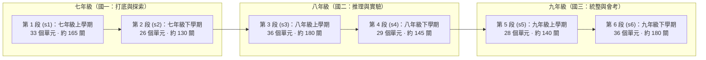
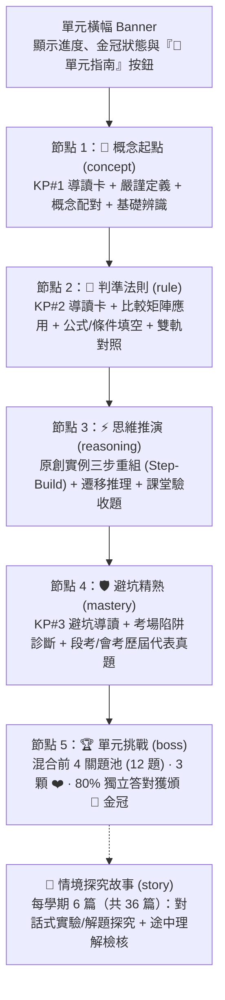

# 知行學院 Quest（JH Quest）｜108 課綱國中三年上下學期全科單元遊戲化學習深度規劃與執行規格書

> **文件版本**：`2026-10-27.v1`（Argon 深度研究與架構規劃版）  
> **目標網站**：`https://waatax.github.io/JH/quest/#learn`（同步支援自訂網域 `https://www.tcool.cc/quest/#learn`）  
> **對標標竿**：`https://waatax.github.io/ENG/quest/#learn`（English Quest v6 / UX7 國中與全階段闖關引擎）  
> **執行策略**：由 **Gemini 4 Argon** 完成深度課綱對齊、資料盤點、遊戲化轉換演算法與 RPDCA 7 輪迭代藍圖；後續可直接交由 **Flash 模型** 依本規格書零歧義逐輪執行、驗證並部署至 GitHub Pages。

---

## 一、 專案願景與核心決策（Executive Summary）

### 1.1 為什麼要做「國中全科遊戲化闖關（JH Quest）」？
目前 `JH`（知行學院）已具備極為深厚的 108 課綱內容基底（8 大領域、21 學科、188 個核心單元、564 個四維明確知識點、564 幅專屬 SVG 資訊圖表、188 組原創實例思維鏈、17 份跨版本段考預備卷、1,674 題會考官方題庫與 2,216 題學測題庫）。然而，現有介面屬於「百科全書與工作台式」入口，國中生在日常自學時容易面臨「選擇過載、缺乏每日推進目標、長文閱讀門檻高」的痛點。

對標姊妹站 [`ENG/quest/#learn`](https://waatax.github.io/ENG/quest/#learn) 的成功經驗，我們將知行學院的完整教材轉化為 **「每天知道下一步的國中三年全科闖關旅程（JH Quest）」**：
1. **三年六學期 × 全科單元展開**：嚴格依據教育部 108 課綱（第四學習階段 VII–IX 年級），將 **七上、七下、八上、八下、九上、九下** 共 6 個學期（主線 Sections `s1`–`s6`）的 **188 個單元**，以及 **10 大學科專精線＋段考與會考衝刺支線**（目標分支 Branches），全面展開為一條可視化、左右交錯的 Duolingo 式闖關路徑。
2. **微粒化短課與多元題型（Micro-learning & Multi-modal Interactions）**：將每個單元的「明確知識點、比較矩陣、思維鏈步驟、易錯陷阱、段考與會考真題」拆解為 **5 個闖關節點（🌱 概念起點 → 📐 判準法則 → ⚡ 思維推演 → 🛡️ 避坑精熟 → 🏆 單元挑戰 Boss）**，每關 8–12 步，支援 **單選、多維配對、推理步驟重組（Step-Build）、核心詞／數值填空、真題圖解判讀** 等互動題型。
3. **無懲罰探索與真實學習證據**：
   - **一般課程不扣愛心（No Hearts on Lessons）**：學習過程允許犯錯，答錯立即給予「錯因病理與避坑提示」，並在課尾自動排入「當場修復（Repair）」佇列。
   - **單元挑戰（Boss Node）3 顆愛心與 80% 獨立答對門檻**：通過獲得金冠（👑）與單元寶箱（💎），並啟動 **1 → 3 → 7 → 14 → 30 天跨日固定間隔複習（Spaced Repetition）**。
4. **雙向無縫互通**：闖關路徑上的每個單元均附帶「📘 單元指南（含知識點 SVG 圖表、板書公式與避坑對照）」，並可一鍵跳轉至主站 `#/lesson/:id` 或橫式全螢幕研經工作台；主站首頁與導覽列亦增設醒目的「🎮 闖關模式（Quest）」入口。

---

## 二、 現有教材資產深度盤點與遊戲化映射（Asset Inventory & Mapping）

經實測讀取 `dist/` 下所有 ESM 模組與 JSON 資料庫，全站現有可轉化為遊戲關卡的結構化資產如下表所示：

| 來源模組 (`dist/`) | 實測數量與結構 | 在 JH Quest 中的轉換用途 | 品質閘門與防失真設計 |
| :--- | :--- | :--- | :--- |
| [`curriculum.js`](file:///c:/Users/User/OneDrive/文件/Antigravity/JH/dist/curriculum.js) (`units`, `questions`) | 21 科、188 單元（含 `concept`, `example`, `pitfall`, `task`）＋ 376 道基礎／應用單選題 | **主線與學科分支的單元骨架**：每單元必備 2 道核心驗收題與避坑對照 | 100% 保留原始題目 ID 與詳解；選項順序於執行時依隨機種子打亂 |
| [`explicit-knowledge-points.js`](file:///c:/Users/User/OneDrive/文件/Antigravity/JH/dist/explicit-knowledge-points.js) | 188 單元 × 3 點 ＝ **564 個明確知識點**（含 `title`, `core`, `mechanism`, `formula`, `examIntel`, `practicalTip`, `infograph.svg`） | **觀念卡（Info Card）＋概念／法則／避坑選擇題與填空題**：每點轉換為 1 張圖解導讀卡＋2~3 道判準／避坑互動題（約 1,692 步） | 自動過濾固定套話；利用同單元／同科其他知識點之 `core`、`formula` 與 `practicalTip` 合成高鑑別度誘答項 |
| [`teaching.js`](file:///c:/Users/User/OneDrive/文件/Antigravity/JH/dist/teaching.js) (`teachingTables`) | 188 份專屬比較表（共 **1,137 列**，每單元 3～8 列，每列 3 欄：`[概念/對象, 核心特徵/法則, 實例/界線]`） | **概念配對題（Match）＋條件分類題（Choice）**：將表格列轉為左右連連看配對題與「給定實例反推法則」題（約 750 題） | 配對題每組 3～4 對，確保左欄與右欄正規化後 100% 唯一、無重疊字義 |
| [`worked-cases.js`](file:///c:/Users/User/OneDrive/文件/Antigravity/JH/dist/worked-cases.js) & [`exegesis-data.js`](file:///c:/Users/User/OneDrive/文件/Antigravity/JH/dist/exegesis-data.js) | 188 組原創實例與板書推演（每組含 `problem`, 3 個 `steps`, `check`, `definitions`, `examEye`） | **推理步驟重組題（Step-Build）＋互動探究故事（Case Story）**：學生依序點選步驟完成解題推導（約 376 題＋36 篇跨科探究故事） | 步驟卡隱藏序號（1/2/3），加入 1～2 個該單元常見迷思步驟作為干擾項，考驗真實邏輯順序 |
| [`lesson-deepening.js`](file:///c:/Users/User/OneDrive/文件/Antigravity/JH/dist/lesson-deepening.js) | 188 組雙軌易混概念對照（`leftLabel`/`left` vs `rightLabel`/`right`）＋ 188 道原創推理問答（`prompt`/`answer`） | **二選一概念辨析快問快答＋遷移推理題**（約 376 題） | 將雙軌對照轉為情境歸類題，強化易混淆概念（如：位移 vs 路程、內心 vs 外心、山脊 vs 山谷）之秒判能力 |
| [`exam-bank.js`](file:///c:/Users/User/OneDrive/文件/Antigravity/JH/dist/exam-bank.js) | 64 道跨單元素養題組、20 道英語聽力題（TTS 語音）、2 道數學非選自評 | **精熟節點（Drill）與英語聽力題（Listen）**（84 題） | 聽力題支援語音播放與「🐢 慢速播放」，並提供「不方便聽？改看文字（不計入聽力統計）」無障礙備援 |
| [`periodic-exam-data.js`](file:///c:/Users/User/OneDrive/文件/Antigravity/JH/dist/periodic-exam-data.js) | 17 份三次段考卷（七上至九下），含 **140 道名校段考精選題**與 **85 條段考高頻陷阱警示** | **「三次段考衝刺」目標分支（`b-periodic`）**，同時按年級學期注入對應單元的精熟題池 | 保留名校出處標記（如臺北市金華國中、臺中市居仁國中等）與 `thinkingTrap` 深度解析 |
| [`cap-bank.json`](file:///c:/Users/User/OneDrive/文件/Antigravity/JH/dist/cap-bank.json) | 109～115 年會考 41 份試卷共 **1,674 道官方試題**（100% 綁定 `unitIds`、附 `crops` 原題截圖與四步詳解） | **「會考歷屆實戰」目標分支（`b-cap`）**，並精選各單元代表性歷屆真題注入主線單元之「🎯 精熟／🏆 挑戰」節點 | 支援題幹圖片（`../cap-img/...`）點擊放大檢視；將選項 A/B/C/D 轉為真實選項文字並移除詳解中寫死的選項字母 |

---

## 三、 108 課綱國中三年上下學期 × 全科單元展開架構（Curriculum Architecture）

為了讓國中生既能**「跟著學校學期進度走（橫向六學期）」**，又能**「針對單一弱科或會考專項特訓（縱向學科與考試分支）」**，JH Quest 採用 **「雙軸導航架構（6 學期主線 Sections ＋ 12 條學科與大考分支 Branches）」**。

### 3.1 主線段落（Sections `s1`–`s6`）：國中三年上下學期全展開（共 188 單元）

使用者可透過頂部段落切換器（Track Switcher）自由切換七上至九下任何學期，第 1～6 段預設全部開放自由選關，亦支援「⏩ 學期跳級檢核（Jump Test）」。



#### 各學期（Section）單元分佈明細表（100% 對齊 `dist/curriculum.js` 188 單元）：

| 學期段落 | 國語文 | 英語文 | 數學 | 自然科學（生/物/化/地） | 社會（史/地/公） | 藝能・科技・健體・綜合・本土 | 單元總數 |
| :--- | :--- | :--- | :--- | :--- | :--- | :--- | :---: |
| **第 1 段 (`s1`) 七上** | `chinese-1, 7` (2) | `english-1, 7` (2) | `math-1..4` (4) | **生物**：`biology-1..3, 7, 8, 14` (6) | **歷史**：`history-1, 2, 9` (3)<br/>**地理**：`geography-1, 2, 8` (3)<br/>**公民**：`civics-1, 7` (2) | 視藝1、音樂1、表藝1、資訊1、生科1、健教1、體育1、家政1、童軍1、輔導1、本土1 (11) | **33** |
| **第 2 段 (`s2`) 七下** | `chinese-2, 8` (2) | `english-2, 8, 13` (3) | `math-5..8, 21` (5) | **生物**：`biology-4..6, 9..13` (8) | **歷史**：`history-3, 4, 13` (3)<br/>**地理**：`geography-3, 11` (2)<br/>**公民**：`civics-2, 10` (2) | 本土語文／臺灣手語：`local-2` (1) | **26** |
| **第 3 段 (`s3`) 八上** | `chinese-3, 9, 13` (3) | `english-3, 9, 14` (3) | `math-9..12` (4) | **物理**：`physics-1..3, 8, 9, 14` (6)<br/>**化學**：`chemistry-1, 2, 13` (3) | **歷史**：`history-5, 10` (2)<br/>**地理**：`geography-4, 9` (2)<br/>**公民**：`civics-3, 11` (2) | 視藝2、音樂2、表藝2、資訊2、生科2、健教2、體育2、家政2、童軍2、輔導2、本土3 (11) | **36** |
| **第 4 段 (`s4`) 八下** | `chinese-4, 10, 14` (3) | `english-4, 10` (2) | `math-13..15, 22..24` (6) | **物理**：`physics-4, 10` (2)<br/>**化學**：`chemistry-3..5, 7..10, 14` (8) | **歷史**：`history-6, 11, 14` (3)<br/>**地理**：`geography-5, 12` (2)<br/>**公民**：`civics-4, 8` (2) | 本土語文／臺灣手語：`local-4` (1) | **29** |
| **第 5 段 (`s5`) 九上** | `chinese-5, 11, 15` (3) | `english-5, 11, 15` (3) | `math-16, 17, 20, 25` (4) | **物理**：`physics-5, 6, 15` (3)<br/>**地科**：`earth-1..3, 7..9, 11` (7) | **歷史**：`history-7, 12` (2)<br/>**地理**：`geography-6, 10, 13` (3)<br/>**公民**：`civics-5, 9, 12` (3) | （九上全力聚焦五考科核心推進） (0) | **28** |
| **第 6 段 (`s6`) 九下** | `chinese-6, 12, 16` (3) | `english-6, 12, 16` (3) | `math-18, 19, 26, 27` (4) | **物理**：`physics-7, 11..13` (4)<br/>**化學**：`chemistry-6, 11, 12` (3)<br/>**地科**：`earth-4..6, 10, 12` (5) | **歷史**：`history-8, 15` (2)<br/>**地理**：`geography-7` (1)<br/>**公民**：`civics-6` (1) | 視藝3、音樂3、表藝3、資訊3、生科3、健教3、體育3、家政3、童軍3、輔導3 (10) | **36** |
| **合計** | **16 單元** | **16 單元** | **27 單元** | **55 單元** (生14/物15/化14/地12) | **40 單元** (史15/地13/公12) | **34 單元** (11 科跨領域素養) | **188 單元** |

> [!TIP]
> **學期內單元排序原則（Pedagogical Sequencing）**：在每個學期（Section）內部，單元並非雜亂排列，而是依「**語文（國、英）→ 數學 → 自然（生/物/化/地）→ 社會（史/地/公）→ 跨域素養（科技/藝術/健體/綜合/本土）**」的螺旋式模塊排列，且使用者可在路徑頂部使用 **「學科快速篩選晶片（Subject Filter Chips：全部／國文／英文／數學／自然／社會／跨域素養）」**，一鍵在「全科交錯闖關」與「單科專注闖關」之間自由切換！

### 3.2 目標分支（Branches）：學科縱貫線、段考衝刺與會考實戰

除了六學期主線外，仿照 `ENG/quest` 的 `BRANCHES` 設計，提供 **8 條目標分支**（共用底層單元與題目進度，在任一處完成節點，主線與分支同步點亮！）：

1. **`b-chinese`（📜 國語文縱貫專精）**：串聯七至九年級 16 個國文單元（字詞修辭、六書、語法、文言虛字、近體詩、宋詞元曲、古典小說、白話散文、議論思辨、應用文、會考寫作）。
2. **`b-english`（🔤 英語文縱貫專精）**：串聯七至九年級 16 個英文單元＋20 題英聽特訓（五大句型、時態全集、不定詞動名詞、被動、關係子句、名詞子句、跨文本閱讀），並提供直連姊妹站 [`waatax.github.io/ENG/quest/#learn`](https://waatax.github.io/ENG/quest/#learn) 的深度進修橋接。
3. **`b-math`（📐 數學推理全線）**：串聯七至九年級 27 個數學單元（數與量、代數方程式、函數與坐標、平面幾何與證明、圓與三心、立體圖形、統計機率）。
4. **`b-science`（🔬 自然科學探究全線）**：串聯生物（14）、理化物理（15）、理化化學（14）、地球科學（12）共 55 個單元。
5. **`b-social`（🌍 社會脈絡思辨全線）**：串聯歷史（15）、地理（13）、公民與社會（12）共 40 個單元。
6. **`b-life`（🎨 科技・藝術・健體・綜合全線）**：串聯資訊、生科、視藝、音樂、表藝、健教、體育、家政、童軍、輔導、本土語／手語共 34 個單元。
7. **`b-periodic`（📝 三次段考衝刺支線）**：將 `periodic-exam-data.js` 的 **17 份段考預備卷（7-1-1 至 9-2-2）** 轉化為 17 個段考挑戰單元，收納 140 道名校段考題與 85 個段考陷阱拆解。
8. **`b-cap`（🎯 會考歷屆實戰支線）**：將 `cap-bank.json` 的近七年（109～115 年）五科會考真題依學科與高頻主題組成會考特訓關卡，支援高清原圖（`cap-img`）與四步破題法。

---

## 四、 單元關卡微結構與多元互動題型規格（Unit Nodes & Item Factories）

每個課綱單元（共 188 個）在遊戲路徑上均展開為 **5 個標準節點（Nodes）**，外加每 3～5 個單元穿插 1 個 **📖 跨科情境探究故事節點（Story Node）**：



### 4.1 六大遊戲化題型產生器（Deterministic Item Factories）

在建置腳本 `scripts/build_quest_course.mjs` 中，我們不依賴隨機外部 API，而是以 **100% 決定性演算法（Deterministic FNV-1a Hash Seeding）** 從現有高品質教材合成以下 6 種題型，確保每次 `npm run build` 產出的題目 ID 與選項完全穩定：

| 題型代碼 (`type`) | 互動方式與介面表現 | 資料來源與合成邏輯 | 評分與回饋機制 |
| :--- | :--- | :--- | :--- |
| **`info`**<br/>（觀念圖解卡） | 呈現知識點標題、核心公式膠囊、機轉說明與 **內嵌 SVG 專屬圖表（`infograph.svg`）**，支援點擊放大與語音朗讀 | `explicitKnowledgePoints[uid][0..2]` 及 `exegesisData[uid].blackboard` | 不計分（Non-scored），作為新課前 1～2 步的認知鷹架；重練時自動略過以加速刷題 |
| **`choice`**<br/>（四選一／二選一判準） | 支援鍵盤 `1`–`4` 快速選答；包含題幹、選用閱讀短文（`passage`）或會考原題圖（`img`） | 1. `curriculum.js` 376 題<br/>2. `explicitKnowledgePoints` 核心定義／考點雷達／避坑防線合成題<br/>3. `lessonDeepening` 雙軌辨析題<br/>4. `periodicExams` 140 題 & `cap-bank` 精選題 | 答對變綠並顯示為什麼對；答錯變紅、標出正解並顯示 `why`（破題步驟）與 `correctionTip`（錯因避坑） |
| **`match`**<br/>（概念矩陣配對） | 左右兩欄各 3～4 張卡片（左：概念／術語／對象；右：定義／判準法則／具體實例），先點左再點右完成消去 | `teachingTables[uid].rows`（188 張表共 1,137 列）及 `exegesisData[uid].definitions` | 配錯時閃爍紅框提示並累計配錯次數；全部配對完成後自動觸發檢查，配錯 ≤ 1 次算首次獨立答對 |
| **`build`**<br/>（思維鏈步驟重組／排句） | **理科／社科／國文**：給定實例問題，將打亂的 3 個推演步驟卡（加上 1～2 個迷思干擾步驟）依正確邏輯順序排出<br/>**英語科**：依中文提示排出正確英文句子 | `workedCases[uid].steps`、`exegesisData[uid].blackboard.heuristicSteps`、`subjectChallenges` | 點擊字卡／步驟卡即可排入或撤回（免拖曳，無障礙友善）；排錯時提示「第一步應先確認哪個條件」 |
| **`input`**<br/>（關鍵術語／數值計算填空） | 在公式、定義或計算題中挖空核心關鍵詞或計算結果（例如：`−3＋8＝_____` 或 `顯微鏡總倍率＝目鏡倍率 × _____`），並提供字首／字數或單位提示 | `exegesisData[uid].definitions`（挖空 `term`）、`teachingTables[uid]` 核心術語、數學／理化計算題數值 | 採用 NFKC 正規化比對（`normalize`），忽略全半形、大小寫與多餘空白，並支援同義詞陣列 `alternatives` |
| **`listen`** & **`line`**<br/>（英聽／語音辨識與探究故事對話） | **`listen`**：播放英語或國語文古詩詞朗讀選答，附慢速播放與「改看文字」按鈕<br/>**`line`**：探究故事中由導師與吉祥物「知知」逐步展開真實情境對話 | `exam-bank.js` (`listening`)、英語單元例句，以及由 `workedCases` 與 `subjectChallenges` 轉化之 **36 篇跨科探究故事** | 聽力題若點選「改看文字」，當題不扣分但不計入「聽力特訓」能力統計（誠實證據原則） |

### 4.2 題庫規模預估（Content Volume Budget）
透過上述產生器，全站 188 個單元＋17 個段考單元將穩定產出：
- **主線 6 大學期（188 單元）**：**940 個關卡節點**（每單元 5 個節點：概念、法則、推演、精熟、Boss 挑戰）。
- **段考與會考分支**：**85 個特訓節點**。
- **互動探究故事（Case Stories）**：**36 篇**（每學期 6 篇，涵蓋語文、數學、自然、社會與跨域生活情境）。
- **總計可作答互動題目與步驟**：約 **4,500+ 道結構化題目**（含 564 張 SVG 圖解觀念卡、1,500+ 道知識點與雙軌判準題、376 道課綱驗收題、376 道思維鏈重組／配對題、140 道名校段考題、以及 1,500+ 道會考歷屆分類真題）。

---

## 五、 遊戲引擎、學習科學與 UI/UX 設計（Engine & Experience Design）

完全對齊 `ENG/quest` 的高標準純邏輯引擎與響應式介面，並針對國中全科特性升級：

### 5.1 學習科學與遊戲化規則（`dist/quest/engine.mjs`）
1. **純函數與依賴注入**：`engine.mjs` 不操作任何 DOM，外部注入 `storage`（預設 `localStorage`，鍵名 `jh-quest-game-v1`）與 `now()`，使所有跨日、凍結卡、XP 去重與複習排程 100% 可由 `node --test` 自動化單元測試驗證。
2. **雙儲存互通與零衝突**：
   - 闖關進度獨立儲存於 `localStorage['jh-quest-game-v1']`，絕不破壞或覆蓋主站既有的 `localStorage['zhixing_state_v3']`。
   - 提供「🔄 同步主站學習紀錄」功能：若使用者已在主站完成某單元的驗收題，可在闖關模式中一鍵將該單元標記為 `tested`（已測過），或將闖關答對紀錄同步回主站。
3. **程度定位檢測（Placement Test）**：
   - 首次進入（或點擊頂部「🧭 程度檢測」）可選 **10 題快速定位（約 3 分鐘）**、**20 題標準檢測（五科均衡取樣）** 或 **30 題深入診斷（含會考精熟挑戰題）**。
   - 依七上至九下（`s1`–`s6`）及五大考科表現，給出「建議起點學期」與「各科強弱項雷達分析」，檢測過程獨立作答，完成後統一揭曉詳解。
4. **XP、寶石、連續天數與每日任務**：
   - **每日目標**：輕鬆（10 XP／約 5 分鐘）、一般（20 XP／約 10 分鐘）、認真（30 XP／約 15 分鐘）、會考衝刺（50 XP／約 20 分鐘）。
   - **XP 獎勵與防刷機制**：新課 +10 XP（全對再 +5 XP）、Boss 挑戰 +20 XP（未過 +5 XP）、探究故事 +10 XP、到期複習 +10 XP、跳級成功 +30 XP。同一節點單日最多領取 3 次獎勵，以 `session.id` 嚴格去重。
   - **每日任務（3 項）與寶箱**：依本地日期決定性抽取 3 項任務（如：獲得 30 XP、完成 2 堂課、一次連對 6 題、訂正 3 題錯題、讀完 1 篇探究故事），單項完成 +10 💎，三項全滿開寶箱 +20 💎。
   - **凍結卡（Streak Freeze）**：100 💎 兌換 1 張（上限 2 張），漏學日自動抵扣保住連續天數 🔥。
5. **課內修復（In-lesson Repair）與跨日複習（1→3→7→14→30 天）**：
   - 課中答錯的題目會排入當場課尾重測（標示「· 再試一次」），但首次答錯已記錄於 `firstTry`，確保正確率與 Boss 80% 門檻不被灌水。
   - 課中連錯 2 題時，自動插入該單元的「💡 核心觀念救援卡」穩定學習者信心。
   - 錯題自動收入「📕 錯題本」，需在後續不同場次連續獨立答對 2 次才正式畢業移出。

### 5.2 視覺與 UI/UX 介面規格（`dist/quest/view.mjs` & `quest.css`）
1. **五分頁全響應式導覽**：
   - **🏠 學習（`#learn`）**：頂部學期／分支選擇器、學科篩選晶片（全部／國／英／數／自／社／素養）、今日遠征推薦卡（Next Adventure）、6 學期進度總覽地圖（Course Atlas）、固定置頂（Sticky）的單元橫幅，以及 S 型交錯的圓形立體關卡節點與原創吉祥物 **「知知（ZhiZhi，帶著博士帽的小貓頭鷹／嫩芽知識精靈 SVG）」**。
   - **💪 練習（`#practice`）**：到期複習單元、📕 錯題本清剿、🎲 全科個人化弱點特訓（鎖定預估答對率約 70% 的甜蜜點題目）、📝 段考快篩與 🎯 會考精選特訓。
   - **📖 故事（`#stories`）**：36 篇跨科情境探究故事（如：「潛水員的數線危機」、「大稻埕茶商的開港日記」、「急診室裡的滲透壓之謎」），邊聽邊讀邊解題。
   - **📚 教材（`#library`）**：188 單元完整指南速查表（支援年級、學期、學科與關鍵字即時過濾），一鍵打開「📘 單元指南彈窗（含 SVG 圖表與公式表）」或直連主站 `#/lesson/:id` 全螢幕研經工作台。
   - **🙂 我的（`#profile`）**：連續學習天數日曆、12 枚全科成長徽章（Badges）、各學期與各科精熟度統計、每日目標／音效／語音速率／深淺色主題設定、以及 JSON 學習紀錄備份匯出與匯入。
2. **無障礙與行動端極致體驗（UX7 標準）**：
   - 嚴格通過 `320px`、`390px`、`768px`、`1280px` 零橫向捲動（Zero Horizontal Overflow）。
   - 手機端首屏即可直接看到並點擊第一個可玩關卡（`y < 560px`），單元橫幅捲動時固定於頂列下方。
   - 支援完整鍵盤操作（`1`–`4` 選選項、`Enter` 檢查與下一題、`Esc` 關閉彈窗），且色彩對比度符合 WCAG AA（≥ 4.5:1），同時支援淺色與深色模式（Dark Mode）。

---

## 六、 工程檔案結構與 GitHub Pages 部署規範（Engineering & Deployment）

```text
JH/
├── index.html                        # 根目錄跳轉頁
├── dist/                             # GitHub Pages 唯一發布根目錄 (由 deploy.yml 發布)
│   ├── index.html                    # 主站首頁（新增醒目「🎮 闖關模式 Quest」入口與導覽）
│   ├── app.js / style.css / sw.js    # 主站應用與 Service Worker (升級快取版本納管 quest/)
│   ├── quest/                        # 【本次新建】國中全科遊戲化闖關核心模組
│   │   ├── index.html                # 闖關模式獨立入口 (waatax.github.io/JH/quest/#learn)
│   │   ├── quest.css                 # 闖關模式響應式與深淺色樣式表
│   │   ├── engine.mjs                # 純邏輯遊戲引擎（組課、評分、XP、連續天數、複習、檢測）
│   │   ├── view.mjs                  # 闖關介面渲染與事件委派控制器
│   │   ├── placement.mjs             # 10/20/30 題跨學期全科程度定位演算法
│   │   ├── coach.mjs                 # 錯因診斷回饋與語音合成朗讀輔助
│   │   ├── sound.mjs                 # WebAudio 合成音效（答對、連對、過關、點擊）與 TTS
│   │   ├── atlas.mjs                 # 六學期與八大分支進度地圖與推薦引擎
│   │   └── course/                   # 建置產出之靜態分片題庫（進入該段才載入，首屏極速）
│   │       ├── index.json            # 全站段落、分支、188 單元與節點結構索引
│   │       ├── s1.json .. s6.json    # 七上至九下 6 個學期之單元題庫與指南
│   │       ├── b-periodic.json       # 17 份三次段考衝刺分支題庫
│   │       ├── b-cap.json            # 會考歷屆實戰分支題庫
│   │       └── stories.json          # 36 篇跨科情境探究故事
├── data/
│   └── quest-review/                 # 逐輪品質校審與題目修正補丁 (*.json)
├── scripts/
│   ├── build_quest_course.mjs        # 【核心建置器】讀取 dist/* 教材 → 生成題庫、品質閘門、輸出報告
│   ├── test_quest_game.mjs           # 【引擎與資料測試】驗證課程結構、XP 去重、複習、跳級、程度檢測
│   ├── qa_quest_game.mjs             # 【端到端驗證】驗證所有路由、DOM 結構、資產完整性與響應式指標
│   └── serve.mjs                     # 升級支援資料夾預設 index.html (如 /quest/ 自動解析 /quest/index.html)
└── docs/
    └── quest-redesign/
        ├── JH-QUEST-MASTER-PLAN.md   # 本規劃規格書
        ├── COURSE-BUILD-REPORT.json  # 建置自動產出之題量、題型分布與排除紀錄
        └── RPDCA-ITERATION-LOG.md    # 逐輪研究、規劃、執行、確效、校正紀錄
```

> [!IMPORTANT]
> **保護既有測試與部署管線（Zero Regression Guarantee）**：
> 1. [`package.json`](file:///c:/Users/User/OneDrive/文件/Antigravity/JH/package.json) 中原有的 `npm test` 與 `npm run build` 包含 15 個既有測試腳本（如 `validate.mjs`、`check-expansion.mjs`、`audit-system-health.mjs`、`test_all_pages.mjs`）。
> 2. **絕對不可修改或刪減** `dist/curriculum.js`、`dist/worked-cases.js`、`dist/teaching.js`、`dist/cap-bank.json`、`dist/gsat-database.json` 的既有匯出結構與題數。
> 3. 注意 [`scripts/validate.mjs`](file:///c:/Users/User/OneDrive/文件/Antigravity/JH/scripts/validate.mjs) 第 24 行會掃描 `dist/` 下第一層的 `.js` 與 `.html` 中的相對路徑引用；將闖關模組放在子目錄 `dist/quest/` 並使用 `.mjs` 副檔名，既能保持架構乾淨，又完全相容既有靜態檢查！

---

## 七、 Flash 模型接手執行之 7 輪 RPDCA 優化迭代藍圖（Execution Runbook for Flash）

請後續執行的 **Flash 模型** 嚴格依照以下 **R1 → R7 七輪 RPDCA（研究 Research → 規劃 Plan → 執行 Do → 確效 Check → 校正 Act）閉環** 依序推進，不跳步、不省略任何測試：

### 🔄 Round 1 (R1)：全科課程產生器與六學期題庫建置（Content Pipeline & Quality Gate）
- **R / P**：讀取 `dist/curriculum.js`、`explicit-knowledge-points.js`、`teaching.js`、`worked-cases.js`、`exegesis-data.js`、`lesson-deepening.js`、`exam-bank.js`、`periodic-exam-data.js` 與 `cap-bank.json` 的匯出結構。
- **D（執行）**：
  1. 撰寫 `scripts/build_quest_course.mjs`，實作 `s1`–`s6`（七上至九下共 188 單元）與 8 條目標分支（`b-chinese`, `b-english`, `b-math`, `b-science`, `b-social`, `b-life`, `b-periodic`, `b-cap`）的轉換邏輯。
  2. 為每單元生成 5 個節點（`concept`, `rule`, `reasoning`, `mastery`, `boss`）及完整單元指南 `guide`（整合 3 個知識點、SVG 圖解、比較矩陣、板書公式、避坑指南与 108 課綱指標代碼）。
  3. 為每學期生成 6 篇（共 36 篇）跨科情境探究故事（`stories.json`）。
  4. 內建嚴格的 **題目品質閘門（`validChoice`, `validMatch`, `validBuild`, `cleanText`）**：自動清除詳解中寫死的選項代號（如「故選 (B)」）、剔除重複或空白選項、確保排句與步驟重組題干擾項合理。
  5. 執行 `node scripts/build_quest_course.mjs` 產出 `dist/quest/course/*.json` 與 `docs/quest-redesign/COURSE-BUILD-REPORT.json`。
- **C / A（確效與校正）**：確認 188 個單元 100% 納入、零空題池節點、所有題目 ID 全域唯一，若有任何單元題數不足自動將相鄰節點合併或補充知識點變式題。

### 🔄 Round 2 (R2)：純邏輯闖關引擎與全科程度定位檢測（Game Engine & Placement）
- **R / P**：參照 `../ENG/dist/quest/engine.mjs` 與 `placement.mjs`，設計適用於國中 6 學期與 21 學科的狀態機與診斷演算法。
- **D（執行）**：
  1. 建立 `dist/quest/placement.mjs`：支援 10／20／30 題全科程度檢測，依七上至九下難度分層抽樣（涵蓋國、英、數、自、社），計算建議起點學期（`s1`–`s6`）與五科能力雷達。
  2. 建立 `dist/quest/coach.mjs`、`dist/quest/atlas.mjs` 與 `dist/quest/sound.mjs`（支援中英文 Web Speech API 朗讀與 WebAudio 音效）。
  3. 建立 `dist/quest/engine.mjs`：實作課程註冊、節點解鎖（`s1`–`s6` 自由選關＋跳級測驗）、課內佇列組合（觀念卡在前、由淺入深、錯題課尾重測、連錯 2 題插入救援提示）、XP 去重、每日任務、寶石與凍結卡、12 枚成就徽章、錯題本（連對 2 次移除）、1/3/7/14/30 天複習排程、以及 JSON 備份匯出入。
- **C / A（確效與校正）**：撰寫並執行 `scripts/test_quest_game.mjs`（至少 20 項自動化單元測試），驗證所有邊界條件（重複送出結算、午夜跨日、凍結卡抵扣、損壞的 localStorage 恢復、題庫完整性）。

### 🔄 Round 3 (R3)：響應式闖關介面、SVG 圖解整合與無障礙體驗（UI/UX & View Layer）
- **R / P**：參照 `../ENG/dist/quest/view.mjs` 與 `quest.css`，設計支援國中全科公式、SVG 資訊圖表、會考圖片與學科篩選的闖關介面。
- **D（執行）**：
  1. 建立 `dist/quest/index.html`、`dist/quest/quest.css` 與 `dist/quest/view.mjs`。
  2. 實作「學習（`#learn`）」、「練習（`#practice`）」、「故事（`#stories`）」、「教材（`#library`）」、「我的（`#profile`）」五大分頁。
  3. 在 `#learn` 路徑頁加入 **「學科快速篩選列（全部／國文／英文／數學／自然／社會／跨域素養）」**，讓學生在同一學期內可自由看全科或單科路徑。
  4. 在單元指南（Guide Modal）與觀念卡（Info Card）中完美渲染 `explicit-knowledge-points.js` 的 **SVG 資訊圖表** 與 `teaching.js` 的比較表，並提供「前往主站研經工作台（`../#/lesson/:id`）」與英文科「前往 English Quest 深度闖關（`https://waatax.github.io/ENG/quest/#learn`）」的跨站橋接。
  5. 升級 `scripts/serve.mjs` 支援目錄預設 `index.html`（使 `/quest/` 可直接開啟）。
- **C / A（確效與校正）**：檢查深淺色模式對比度（≥ 4.5:1）、手機首屏關卡可見度、鍵盤 `1`–`4` 與 `Enter` 操作流暢度。

### 🔄 Round 4 (R4)：題目品質深度審校與學科專屬題型優化（Calibration & Editorial Patching）
- **R / P**：抽檢各學科生成的題目，針對國文（文言虛字、修辭）、英文（句型重組、聽力）、數學（符號與根號公式顯示）、自然（化學式上下標、物理單位）、社會（史料與等高線判讀）進行精細調校。
- **D（執行）**：
  1. 撰寫自動化審校腳本掃描全部生成題目：檢查是否有提示洩漏答案、選項長度嚴重失衡、干擾項與正解語義重疊、或圖片路徑失效。
  2. 將審校修正規則寫入 `data/quest-review/2026-10-27-r4-calibration.json` 並更新 `scripts/build_quest_course.mjs` 重新建置。
- **C / A（確效與校正）**：確保 `COURSE-BUILD-REPORT.json` 中所有校審補丁 100% 套用，零未處理異常。

### 🔄 Round 5 (R5)：主站雙向整合、PWA 離線快取與回歸測試（Main Site Integration & PWA）
- **R / P**：檢視 `dist/index.html`、`dist/app.js`、`dist/sw.js` 與 `package.json`。
- **D（執行）**：
  1. 在 `dist/index.html` 側邊導覽列、手機底部選單與首頁英雄區（Welcome Banner）加入醒目的 **「🎮 全科闖關（Quest）」** 入口（連往 `./quest/#learn`）。
  2. 在主站單元課程頁（`dist/app.js` 的 `#/lesson/:id`）標題旁加入 **「🎮 進入本單元闖關」** 按鈕（連往 `./quest/#learn?unit=:id`）。
  3. 更新 `dist/sw.js` 快取清單與版本號，確保離線環境亦能順暢載入闖關核心資源。
  4. 將 `scripts/test_quest_game.mjs` 納入 `package.json` 的 `npm test` 與 `npm run build` 驗證鏈中。
- **C / A（確效與校正）**：執行完整 `npm test` 與 `npm run build`，確保既有 15 個測試腳本與新增的闖關測試 **100% 全數通過**。

### 🔄 Round 6 (R6)：端到端確效、多視窗響應式驗證與文件更新（E2E Verification & Docs）
- **D / C（執行與確效）**：
  1. 撰寫並執行 `scripts/qa_quest_game.mjs`（測試伺服器 HTTP 200、所有 JSON 分片載入、DOM 渲染、無斷鏈、無遺漏圖片）。
  2. 更新 `README.md` 與 `docs/quest-redesign/RPDCA-ITERATION-LOG.md`，詳實記錄實際產出之單元數、節點數、題目數、故事數與測試結果。
- **A（校正）**：修復任何在端到端驗證中發現的邊界問題，重新執行 `npm run build` 確保產物乾淨一致。

### 🔄 Round 7 (R7)：Git 提交與 GitHub Pages 自動部署發布（GitHub Pages Release）
- **D（執行）**：
  1. 檢查 `git status` 與 `git diff`，確保無臨時廢棄檔案或未預期變更。
  2. 提交所有變更至 `main` 分支（`git add . && git commit -m "feat(quest): launch JH Quest 108 curriculum 6-semester全科遊戲化闖關平台" && git push origin main`）。
- **C（確效）**：驗證 GitHub Actions (`Deploy to GitHub Pages`) 觸發與建置狀態，確認 `https://waatax.github.io/JH/quest/#learn` 正式上線運作。

---

## 八、 交接檢查清單（Handover Checklist for Flash Execution）

當你切換至 **Flash 模型** 開始執行時，只需向它發出簡短指令（例如：「**請依據 `docs/quest-redesign/JH-QUEST-MASTER-PLAN.md` 執行 R1 至 R7 並發布至 GitHub Pages**」），Flash 模型即可依下列清單逐項完成並打勾：

- [ ] **R1 課程與題庫建置**：完成 `scripts/build_quest_course.mjs`，產出 `dist/quest/course/index.json`、`s1..s6.json`、`b-*.json`、`stories.json` 與 `docs/quest-redesign/COURSE-BUILD-REPORT.json`。
- [ ] **R2 遊戲引擎與單元測試**：完成 `dist/quest/engine.mjs`、`placement.mjs`、`coach.mjs`、`atlas.mjs`、`sound.mjs`，並通過 `node --test scripts/test_quest_game.mjs`。
- [ ] **R3 闖關介面與伺服器支援**：完成 `dist/quest/index.html`、`quest.css`、`view.mjs` 及 `scripts/serve.mjs` 目錄路由支援。
- [ ] **R4 題庫校審與補丁**：完成全科題目品質掃描與 `data/quest-review/` 校正補丁，重建課程零錯誤。
- [ ] **R5 主站整合與 PWA 升級**：更新 `dist/index.html`、`dist/app.js`、`dist/sw.js`、`package.json`，通過完整 `npm test` 與 `npm run build`。
- [ ] **R6 端到端 QA 與文件紀錄**：通過 `scripts/qa_quest_game.mjs`，更新 `README.md` 與 `docs/quest-redesign/RPDCA-ITERATION-LOG.md`。
- [ ] **R7 GitHub Pages 部署**：完成 `git commit` 與 `git push origin main`，發布至 `https://waatax.github.io/JH/quest/#learn`。
